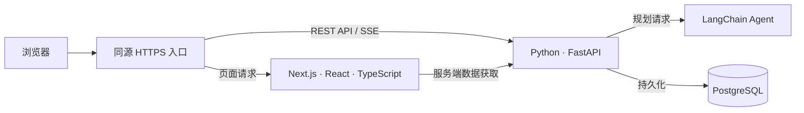

# DevPath

DevPath 是一个面向已有编程基础的自学者的技术学习导航项目。首个 MVP 聚焦 **AI Agent 开发**，帮助学习者根据已有经验和每周可用时间，确定下一步学什么、用哪些资料、做什么练习，并在进度或目标变化时调整计划。

**当前阶段 · 产品与架构设计已确定，MVP 待初始化。** 下文描述的是计划交付的能力。应用代码、可运行版本和本地启动说明均待补充。

## MVP 目标

用一条 AI Agent 开发路线验证完整的学习流程。学习者从当前基础出发，获得一份可执行的计划，完成实践任务、记录反馈，并根据实际进度调整剩余安排。

DevPath 采用**平台知识体系 + AI 个性化规划**。平台维护知识节点、先修关系和经过审核的学习资源。AI 根据学习者的基础、目标、时间预算和反馈，在这套知识体系内安排学习顺序和实践任务。

例如，一名已有 Java 后端经验、每周能投入 4 小时的开发者，可以获得一份包含 Python 基础补课、模型 API 调用和 Tool Calling 实践的候选计划。学习时间减少后，可以根据已有记录重新安排剩余任务。

## 核心功能

| 功能 | MVP 交付目标 |
| --- | --- |
| 公开知识路线 | 浏览 AI Agent 开发路线、知识节点、先修顺序与经过审核的学习资源 |
| 个人学习档案 | 记录技术基础、学习目标和每周可用时间，作为规划依据 |
| 个性化计划 | 生成包含阶段、知识节点、资料和实践任务的候选计划，展示生成进度 |
| 确认与版本管理 | 用户审阅候选计划，确认后发布正式版本，并保留历史版本 |
| 任务、进度与反馈 | 记录任务完成情况，独立记录对知识的掌握程度和遇到的困难 |
| 重新规划 | 根据反馈或时间变化调整后续任务，保留已完成任务的学习记录 |

## 技术架构

| 层级 | 职责 |
| --- | --- |
| **Next.js App Router** | 管理 Web 路由、服务端数据获取和页面渲染。公开路线与知识页按内容采用 SSR 或 SSG，并提供页面元数据和站点地图。 |
| **React + TypeScript** | 实现学习路线交互、档案表单、任务状态、进度和候选计划审阅。生成计划时，通过 `fetch` 提交参数并读取 SSE 事件。 |
| **Python + FastAPI** | 提供统一的 REST API 和 SSE，管理认证、会话、资源授权、知识体系、计划发布与学习进度。Web 端计划采用同源 API 和服务端会话，浏览器使用 `HttpOnly` Cookie。 |
| **LangChain** | 在 FastAPI 应用内编排模型和工具调用，使用平台提供的知识与资源生成结构化候选计划。 |
| **PostgreSQL** | 保存用户档案、知识与资源、计划版本、任务和学习记录，由 Python 后端统一访问。 |

公开内容面向搜索引擎。私人工作台设置 `noindex`，相关接口由 FastAPI 校验会话和数据归属。

## 工程原则

- **业务服务校验 AI 输出。** 校验知识节点和资源引用、先修关系及时间约束。通过校验后保存草稿，用户确认后再发布。
- **计划版本与学习记录可追溯。** 在数据库事务中切换正式版本，保留历史版本及其学习记录。模型推理在发布事务之外执行。
- **基础功能可以独立使用。** 模型服务不可用时，学习者仍可浏览资源、查看已有计划和更新任务进度。
- **以业务边界组织模块。** MVP 由 Web 应用和模块化 Python 后端组成。FastAPI 通过 OpenAPI 描述接口，TypeScript 客户端据此维护接口类型。跨应用复用有实际需求时，再提取共享组件与 API 客户端。

## 开发路线

| 阶段 | 计划交付 |
| --- | --- |
| 1. 项目初始化 | 建立 Next.js 与 FastAPI 应用，打通页面读取后端数据的最小链路 |
| 2. 公开知识路线 | 整理 AI Agent 知识节点、先修关系和资源，验证公开页面的渲染与 SEO |
| 3. 认证与学习档案 | 接入 PostgreSQL，打通登录、会话、访问权限和档案管理 |
| 4. 学习计划与进度 | 实现计划创建、确认、版本保存、任务状态与学习反馈 |
| 5. Agent 个性化规划 | 接入 LangChain、候选计划校验和 SSE，支持根据反馈重新规划 |
| 6. MVP 验证 | 覆盖权限、版本切换和生成失败等关键场景，邀请小规模自学者试用 |

试用阶段重点观察学习者能否快速理解并开始下一项任务、资源是否匹配其基础，以及一周后是否仍愿意记录进度。

后续将根据试用反馈评估其他技术路线和桌面端。桌面端的备选方案为 **React + Vite + Tauri**，通过同一套 FastAPI 接口复用业务能力，并共享与 Next.js 路由和渲染解耦的 React 组件及 TypeScript API 客户端。桌面端认证将在该阶段单独设计。

## 参与贡献

- **提出需求或反馈。** 仓库开放 Issues 后，可以说明你的学习目标、卡住的环节，以及希望改进的体验。
- **推荐学习资源。** 提供来源链接、对应知识节点、适用基础和推荐理由。官方文档、可动手的练习和可复现的项目示例都适合提交。
- **参与代码或文档。** 项目初始化后，可通过 Pull Request 提交改动，说明解决的问题及验证方法。涉及数据模型或 API 契约的改动，建议先在 Issue 讨论。

## 许可证

许可证待确定。
